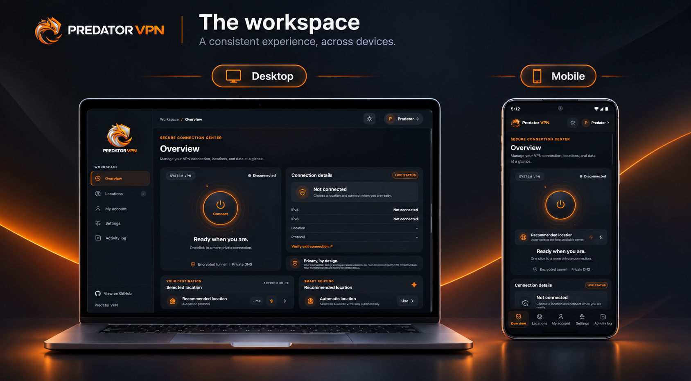

<p align="center"><a href="README.md">English</a> &nbsp; | &nbsp; <a href="README.fa.md">فارسی</a> &nbsp; | &nbsp; <strong>日本語</strong></p>

<p align="center"><picture><source media="(prefers-color-scheme: dark)" srcset="assets/logo-light.png"></picture></p>

<p align="center">
  
  
  
  
  
</p>

<p align="center">
  <a href="#download"><strong>v2.0.7 をダウンロード</strong></a> &nbsp; · &nbsp;
  <a href="#the-workspace">アプリを見る</a> &nbsp; · &nbsp;
  <a href="#get-connected">接続する</a> &nbsp; · &nbsp;
  <a href="#support-the-project">プロジェクトを支援する</a>
</p>

**よりプライベートな接続のための、使い慣れたワークスペース。** Predator VPN は、システム VPN、アプリごとのルーティング、接続の操作をデスクトップとスマートフォンで提供します。インターフェースは英語で、ライト、ダーク、システム設定に合わせた外観を選べます。

**v2.0.7** では DNS の耐障害性が向上し、すべての対応プラットフォームで単一の外部デフォルトサブスクリプションを使用するようになりました。[変更点を見る](https://github.com/erfan-tahvilian/PredatorVPN/releases/tag/v2.0.7).

## PredatorVPN

### v2.0.7 の新機能

- **より安定した接続:** HTTPS のセキュリティを緩めることなく、Android でネットワークの DNS タイムアウトから回復しやすくなりました。
- **より安全なデスクトップのフォールバック:** サービス DNS の一時的なエラーを、独立した読み取り専用のトランスポートを通じて回復できるようになりました。
- **シンプルになったサブスクリプション:** デフォルトで設定されるのは外部の Free-v2ray-Configs リストのみになりました。保存されていた古いリポジトリ内のリンクは廃止されました。
- **これまでどおりの使い心地:** 既存のすべてのアーキテクチャ、アカウント設定、過去のダウンロードは引き続きサポートされます。

使い始めるには、サービスアカウントでサインインしてください。サービスの利用資格、提供状況、データ通信量の上限が適用されます。Predator VPN は独立したクライアントであり、外部のサービスプロバイダーとは提携していません。

<a name="download"></a>

## 📥 ダウンロード

**v2.0.7** · [リリースノートとすべてのファイル](https://github.com/erfan-tahvilian/PredatorVPN/releases/tag/v2.0.7) · [SHA-256 チェックサム](https://github.com/erfan-tahvilian/PredatorVPN/releases/download/v2.0.7/SHA256SUMS.txt)

お使いの OS とプロセッサーに合ったパッケージを選んでください。デスクトップ向けにはインストーラーとポータブル版のアーカイブがあり、Android 向けのパッケージは署名済みの APK です。

デスクトップ向けインストーラー、macOS のディスクイメージ、Linux の AppImage は、アプリケーションと VPN エンジンをすべて含みつつ、コンパクトにパッケージ化されています。ポータブル版の ZIP アーカイブはサイズが大きくなることがあります。

<p align="center">
  <a href="https://github.com/erfan-tahvilian/PredatorVPN/releases/download/v2.0.7/PredatorVPN-2.0.7-Windows-x64.exe"><picture><source media="(prefers-color-scheme: dark)" srcset="docs/readme/download-windows-dark.svg"></picture></a> &nbsp;&nbsp;&nbsp;
  <a href="https://github.com/erfan-tahvilian/PredatorVPN/releases/download/v2.0.7/PredatorVPN-2.0.7-macOS-arm64.dmg"><picture><source media="(prefers-color-scheme: dark)" srcset="docs/readme/download-macos-dark.svg"></picture></a>
</p>
<p align="center">
  <a href="https://github.com/erfan-tahvilian/PredatorVPN/releases/download/v2.0.7/PredatorVPN-2.0.7-x86_64.AppImage"><picture><source media="(prefers-color-scheme: dark)" srcset="docs/readme/download-linux-dark.svg"></picture></a> &nbsp;&nbsp;&nbsp;
  <a href="https://github.com/erfan-tahvilian/PredatorVPN/releases/download/v2.0.7/PredatorVPN-2.0.7-Android-arm64-v8a.apk"><picture><source media="(prefers-color-scheme: dark)" srcset="docs/readme/download-android-dark.svg"></picture></a>
</p>

一般的なデバイス向けのクイックダウンロードです。**対応しているすべてのアーキテクチャは以下の一覧にあります。**

<!-- predatorvpn-downloads:start -->

| プラットフォーム | プロセッサー | パッケージ | おすすめの用途 |
| :--- | :---: | :--- | :--- |
| **Windows**<br><sub>Windows 10 以降</sub> | **x64** | [](https://github.com/erfan-tahvilian/PredatorVPN/releases/download/v2.0.7/PredatorVPN-2.0.7-Windows-x64.exe) &nbsp; [](https://github.com/erfan-tahvilian/PredatorVPN/releases/download/v2.0.7/PredatorVPN-2.0.7-Windows-x64.zip) | ほとんどの Intel / AMD PC |
|  | **x86** | [](https://github.com/erfan-tahvilian/PredatorVPN/releases/download/v2.0.7/PredatorVPN-2.0.7-Windows-x86.exe) &nbsp; [](https://github.com/erfan-tahvilian/PredatorVPN/releases/download/v2.0.7/PredatorVPN-2.0.7-Windows-x86.zip) | 32 ビット版 Windows の PC |
|  | **ARM64** | [](https://github.com/erfan-tahvilian/PredatorVPN/releases/download/v2.0.7/PredatorVPN-2.0.7-Windows-arm64.exe) &nbsp; [](https://github.com/erfan-tahvilian/PredatorVPN/releases/download/v2.0.7/PredatorVPN-2.0.7-Windows-arm64.zip) | ARM 版 Windows 11 |
| **macOS**<br><sub>macOS 13 以降</sub> | **Apple Silicon** | [](https://github.com/erfan-tahvilian/PredatorVPN/releases/download/v2.0.7/PredatorVPN-2.0.7-macOS-arm64.dmg) &nbsp; [](https://github.com/erfan-tahvilian/PredatorVPN/releases/download/v2.0.7/PredatorVPN-2.0.7-macOS-arm64.zip) | M シリーズの Mac |
|  | **Intel x64** | [](https://github.com/erfan-tahvilian/PredatorVPN/releases/download/v2.0.7/PredatorVPN-2.0.7-macOS-x64.dmg) &nbsp; [](https://github.com/erfan-tahvilian/PredatorVPN/releases/download/v2.0.7/PredatorVPN-2.0.7-macOS-x64.zip) | Intel プロセッサー搭載の Mac |
| **Linux**<br><sub>64 ビットデスクトップ</sub> | **x64** | [](https://github.com/erfan-tahvilian/PredatorVPN/releases/download/v2.0.7/PredatorVPN-2.0.7-x86_64.AppImage) &nbsp; [](https://github.com/erfan-tahvilian/PredatorVPN/releases/download/v2.0.7/PredatorVPN-2.0.7-Linux-x64.deb) &nbsp; [](https://github.com/erfan-tahvilian/PredatorVPN/releases/download/v2.0.7/PredatorVPN-2.0.7-Linux-x64.rpm) | Intel / AMD の Linux デスクトップ |
|  | **ARM64** | [](https://github.com/erfan-tahvilian/PredatorVPN/releases/download/v2.0.7/PredatorVPN-2.0.7-aarch64.AppImage) &nbsp; [](https://github.com/erfan-tahvilian/PredatorVPN/releases/download/v2.0.7/PredatorVPN-2.0.7-Linux-arm64.deb) &nbsp; [](https://github.com/erfan-tahvilian/PredatorVPN/releases/download/v2.0.7/PredatorVPN-2.0.7-Linux-arm64.rpm) | 64 ビット ARM の Linux デスクトップ |
| **Android**<br><sub>Android 8 以降</sub> | **ARM64** | [](https://github.com/erfan-tahvilian/PredatorVPN/releases/download/v2.0.7/PredatorVPN-2.0.7-Android-arm64-v8a.apk) | 最近のほとんどの Android スマートフォン |
|  | **Universal** | [](https://github.com/erfan-tahvilian/PredatorVPN/releases/download/v2.0.7/PredatorVPN-2.0.7-Android-universal.apk) | 対応するすべてのアーキテクチャ。ファイルサイズは大きめです |
|  | **ARMv7** | [](https://github.com/erfan-tahvilian/PredatorVPN/releases/download/v2.0.7/PredatorVPN-2.0.7-Android-armeabi-v7a.apk) | 32 ビット ARM のデバイス |
|  | **x86_64** | [](https://github.com/erfan-tahvilian/PredatorVPN/releases/download/v2.0.7/PredatorVPN-2.0.7-Android-x86_64.apk) | 64 ビット Intel のデバイス / エミュレーター |
|  | **x86** | [](https://github.com/erfan-tahvilian/PredatorVPN/releases/download/v2.0.7/PredatorVPN-2.0.7-Android-x86.apk) | 32 ビット Intel のデバイス / エミュレーター |

<!-- predatorvpn-downloads:end -->

**動作要件:** x64/x86 は Windows 10 以降、ARM64 は Windows 11、macOS 13 以降、システムキーリングと polkit を備えた最新の 64 ビット Linux デスクトップ、最新の Android System WebView を搭載した Android 8 以降が必要です。アーキテクチャ別の APK はサイズが小さくなります。わからない場合は Universal を選んでください。

<details>
<summary><strong>インストールの前に: パッケージの信頼性と検証</strong></summary>

ダウンロードしたファイルの SHA-256 ハッシュを [SHA256SUMS.txt](https://github.com/erfan-tahvilian/PredatorVPN/releases/latest) と照合してください。

- **Windows:** パッケージは現在署名されていません。システム VPN には管理者権限が必要です。
- **macOS:** パッケージはアドホック署名されており、公証されていません。初回起動を **System Settings → Privacy & Security → Open Anyway** で許可する前に、ダウンロードしたファイルを検証してください。
- **Linux:** システム VPN は polkit による認可を使用します。アカウントを安全に保存できるよう、デスクトップのキーリングのロックを解除した状態にしておいてください。
- **Android:** APK のアップデートには、プロジェクトの固定の署名 ID が使われます。[公開署名証明書のフィンガープリント](android/signing-certificate.sha256)をご覧ください。

</details>

<a name="the-workspace"></a>

## 🖥️ ワークスペース

接続、選択したロケーション、月間のデータ通信量の上限、セッションのアクティビティをひと目で確認できます。

**複数のアカウントを、ひとつのワークスペースで。** 複数のサービスアカウントを保存し、使用するアカウントを選べます。通信量の上限に達したことが確認されると、自動で切り替わります。接続に使われるアカウントは一度に 1 つです。前回のセッションの通信量とデバイスの累計は、切断や再起動のあとも確認できます。Windows、macOS、Linux、Android で利用できます。

わかりやすい接続ダッシュボード、複数アカウントの管理、通信量の上限、ネットワークの詳細を、ライトとダークの外観で表示します。


<p align="center">
  
</p>
<a name="traffic-on-your-terms"></a>

## 🔀 通信を思いどおりに

どのアプリケーションが VPN を使うかを決められます。スプリットトンネリングには 2 つのルーティングモードがあり、検索できるアプリ選択画面とアプリケーションのアイコンも備えています。

<picture>
  <source media="(prefers-color-scheme: dark) and (max-width: 600px)" srcset="docs/readme/routing-dark-mobile.svg">
  <source media="(max-width: 600px)" srcset="docs/readme/routing-light-mobile.svg">
  <source media="(prefers-color-scheme: dark)" srcset="docs/readme/routing-dark.svg">
  
</picture>

デスクトップのルーティングはアプリケーションのプロセス名に基づき、macOS ではアプリのヘルパープロセスも含まれます。Linux のアプリ検出にはデスクトップランチャーを使用します。サンドボックス化されたアプリやラッパー経由で起動するアプリでは、実際のプロセス名を手動で入力する必要がある場合があります。Android のルーティングはアプリケーションのパッケージに基づきます。ローカルネットワークの通信はトンネルを経由しません。対応プロトコルについては[ネットワークのサポート](#network-support)をご覧ください。

アップデートの確認はアプリを開いたときに始まり、フォアグラウンドに戻ったときに更新されます。新しい安定版リリースは、お使いのデバイスに合った直接ダウンロードとともに表示されます。リリースのハイライトは、アップデートのたびに一度だけ表示されます。Android では、ロケーションの確認がロケーションの選択や接続を妨げずに実行され、戻るボタンを押すとアプリを終了する前に Overview に戻ります。

### さらに便利な操作

| 接続先を見つける | 自分好みにする |
| :--- | :--- |
| **🌍 ロケーションの選択** - おすすめのエンドポイントを使うか、国を手動で選べます。 | **💾 設定の保存** - 設定、ダウンロードしたロケーション、好みのロケーションの並び順はセッションをまたいで保持されます。 |
| **⚡ レイテンシの確認** - 認証済みの VPN トンネルを通じた HTTPS の応答を、1 つまたはすべてのロケーションについて測定し、実際の遅延や名前で並べ替えられます。 | **⚙️ 接続オプション** - システム VPN またはローカルの SOCKS5 プロキシを使用でき、HTTP / SOCKS5 のアップストリームにも対応しています。 |
| **📊 アクティビティをひと目で** - 接続の統計を確認し、診断ログをエクスポートできます。 | **🔐 ローカルの認証情報の保護** - 暗号化されたセッションの保存、設定可能な DNS、サービスアカウントのメール認証と認証アプリのコードに対応しています。 |

**Android:** クイック設定から接続や切断ができ、接続中の状態を示すタイルと常駐通知の操作も備えています。**デスクトップ:** ウィンドウを閉じても、Predator VPN をシステムトレイから使えます。

<a name="get-connected"></a>

## 🚀 接続する

### 1. お使いのデバイスにインストールする

<details open>
<summary><strong>Windows</strong></summary>

インストーラーを実行するか、ポータブル版の ZIP を**すべて**展開して **Predator VPN.exe** を起動します。システム VPN のための管理者権限の要求を承認してください。

</details>

<details>
<summary><strong>macOS</strong></summary>

DMG を開いて **Predator VPN** を **Applications** にドラッグするか、ZIP からアプリバンドル全体を展開します。Gatekeeper によって初回起動がブロックされた場合は、ダウンロードしたファイルを検証してから **System Settings → Privacy & Security → Open Anyway** で許可してください。システム VPN は接続時に管理者の認可を求めます。

</details>

<details>
<summary><strong>Android</strong></summary>

APK をインストールし、求められたらブラウザーやファイルマネージャーからのインストールを許可してください。初回の接続時に、システムの VPN 要求を承認してください。接続の操作を常に表示しておくには、通知を許可してください。

サインインして最初の VPN 接続を承認したら、クイック設定パネルを編集して **Predator VPN** を追加します。タイルをタップすると接続または切断でき、ハイライト表示は接続中であることを示します。

</details>

<details>
<summary><strong>Linux</strong></summary>

Debian/Ubuntu では **DEB** を、Fedora とその互換ディストリビューションでは **RPM** を選んでください。単体のパッケージを使う場合は、**AppImage** に実行権限を付けて起動します。Secret Service のキーリング、polkit、正常に動作する認可エージェントを備えた最新のデスクトップを使用してください。接続時には polkit の要求を承認してください。インターフェース自体は root 権限なしで動作します。

</details>

### 2. サインインし、ロケーションを選んで接続する

外部の接続サービスの有効な既存アカウントが必要です。このプロジェクトではアカウントの登録は提供していません。

1. **My account** を開き、サービスアカウントでサインインします。
2. 求められた場合は、メール認証または認証アプリのコードを入力します。
3. ロケーションを選び、接続ボタンを押します。

**My account** でほかのアカウントを追加し、**Use account** で使用するアカウントを選びます。**Automatic switching** を有効にしておくと、使用中のアカウントのデータ残量がなくなったときに、保存済みの別のアカウントに切り替わります。通信量の上限はアカウントごとに確認され、アカウントを保存しても 1 つのサブスクリプションにまとめられることはありません。

切断するには、もう一度接続ボタンを押します。デスクトップでアプリを完全に終了するには、トレイから **Quit** を選びます。Android では、接続はバックグラウンドで維持されます。

<details>
<summary><strong>ローカルプロキシ経由でアプリケーションを接続する</strong></summary>

Settings で **Proxy-only mode** を有効にします。アプリケーションが `socks5h://127.0.0.1:1080` または指定したポートを使うように設定してください。対象になるのはこのプロキシを使うよう設定したアプリケーションだけで、システムのルートは変更されません。

信頼できるネットワークでプロキシを共有するつもりがない限り、デフォルトのループバックへのバインドのままにしてください。すべてのインターフェースにバインドすると、認証なしのプロキシがそのネットワークに公開されます。

</details>

<a name="network-support"></a>

## 🌐 ネットワークのサポート

Predator VPN はサードパーティの VPN インフラ上に構築された独立したクライアントで、接続はリモートの VPN エッジサーバーを経由します。アカウントの利用資格、地域ごとの提供状況、データ通信量の上限はサービス側で決まります。

| 対応していること | 知っておくべき制限 |
| :--- | :--- |
| トンネルを経由する TCP 通信と DNS | ブラウザーの QUIC やゲームを含む、アプリケーション全般の UDP には対応していません。 |
| Predator VPN とエッジ間の HTTP/2 over TLS または HTTP/3 over QUIC | HTTP/3 には、送信方向の UDP が使えることが必要です。Automatic では、証明書を検証した小さな HTTPS リクエストを両方のプロトコルで比較し、最初に動作した経路を使い続けます。プロトコルの選択で測定するのは接続の応答性であり、継続的なダウンロード速度ではありません。 |
| 設定可能なトンネル経由の DNS とアップストリームプロキシ | ローカルネットワークの通信と、直接接続にルーティングされたアプリはトンネルを経由しません。 |
| アプリごとのルーティングとプロキシのみの接続 | 常時有効なキルスイッチはありません。 |


サービスの検証は、アカウントの認証より前に行われます。サービスの検証エラーが出ても、それだけでパスワードが間違っているとは限りません。サインインの問題を報告するときは、正確なエラーと OS を記載してください。パスワード、認証コード、セッショントークンは決して共有しないでください。

<a name="built-in-the-open"></a>

## 🛠️ オープンな開発

Predator VPN は、Windows、macOS、Linux、Android のすべてで **[GNU General Public License, version 3 or later](LICENSE)** のもとでライセンスされています。[著作権表示](COPYRIGHT)をご覧ください。独立した依存関係には、それぞれ元のライセンスと表示が適用されます。

| 開発者向け | コントリビューター向け |
| :--- | :--- |
| [ソースからビルドする](BUILDING.md) - プラットフォームごとの前提条件とビルド手順です。 | [問題を報告する](https://github.com/erfan-tahvilian/PredatorVPN/issues) - OS、アーキテクチャ、再現手順を記載してください。 |
| [変更履歴](CHANGELOG.md) - リリースの履歴です。 | [リリースノート](RELEASE_NOTES.md) - インストールとリリースの情報です。 |

診断ログを共有する前に、アカウントの詳細、トークン、IP アドレス、その他の機密情報を削除してください。

<details>
<summary><strong>サードパーティのソフトウェアと対応するソースコード</strong></summary>

- **sing-box** - GPL-3.0-or-later で、アップストリームの名称に関する条件が付いています。対応するソースコードそのものを [sing-box-1.12.0-source.tar.gz](https://github.com/erfan-tahvilian/PredatorVPN/releases/download/v2.0.7/sing-box-1.12.0-source.tar.gz) として同梱しています。[表示](licenses/sing-box-NOTICE.txt)と[ソースからのビルド手順](https://sing-box.sagernet.org/installation/build-from-source/)をご覧ください。
- **Wintun** - Windows パッケージに同梱されているライセンスのもとで再配布しています。[Wintun](https://www.wintun.net/) をご覧ください。
- **Electron、Chromium、Node.js と npm の依存関係** - 表示はデスクトップ版の配布物に含まれています。Android のネイティブ依存関係の表示は APK のアセットに含まれています。
- **HTTP/3 トランスポート** - quic-go、qpack、Go の依存関係には、それぞれの MIT/BSD の表示が適用されます。[トランスポートの表示](licenses/http3-NOTICE.txt)をご覧ください。
- **flag-icons** - MIT です。[ライセンスの表示](licenses/flag-icons-MIT.txt)をご覧ください。

</details>

<a name="support-the-project"></a>

## 🧡 プロジェクトを支援する

Predator VPN の開発とメンテナンスの継続にご協力ください。

<a href="https://buymeacoffee.com/ErfanTahvilian">
  <picture>
    <source media="(prefers-color-scheme: dark)" srcset="docs/readme/support-dark.svg">
    
  </picture>
</a>

<details>
<summary><strong>暗号資産で支援する</strong></summary>

**Tron · TRX**

```text
TL8WyZLLGu8UraHAT8dCoeMsnzGpX2oAYn
```

**Binance Coin · BNB · BEP20**

```text
0xeC4F61F21238685cC842bC236D86684e5fc2Bc57
```

**Bitcoin · BTC**

```text
bc1q2y9m8y02fqgsr4c6533duwmqtmrhadc8k8mkt4
```

</details>

<picture>
  <source media="(prefers-color-scheme: dark) and (max-width: 600px)" srcset="docs/readme/signature-dark-mobile.svg">
  <source media="(max-width: 600px)" srcset="docs/readme/signature-light-mobile.svg">
  <source media="(prefers-color-scheme: dark)" srcset="docs/readme/signature-dark.svg">
  
</picture>

[リリースのソースコードと依存関係のソースコード](SOURCES.md)。
